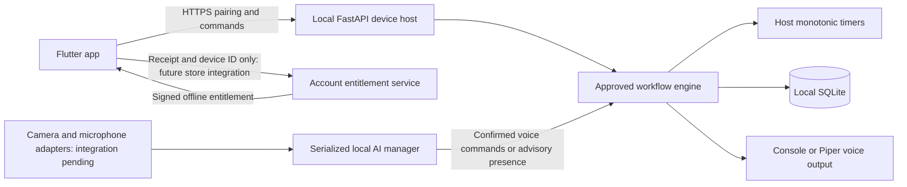

# Architecture and proposal coverage

The phone never fetches camera/audio, interpreted scenes, current step, timers,
or event logs. `/catalog` contains static author-approved content. Device command
acknowledgements have empty bodies; validation errors describe only rejected
commands. The cloud service accepts a receipt, pack and device identity and has
no monitoring input fields or connection back to the device.

| Proposal area | Repository implementation | Remaining integration |
| --- | --- | --- |
| Study, cooking, lab modes | Validated JSON, confirmation guards, illustrative plans | Reviewed production recipes/course protocols |
| Reminders and multiple timers | Host engine, quiet/snooze, absence cooldown | Physical LED cues |
| App connection | HTTPS client, single-use device code, token hashing and secure app storage | Platform scaffolding/certificate provisioning |
| Local data and deletion | SQLite, private DB permissions, deletion/unpair API | Retention policy and durable timer recovery |
| Model coordination | Exclusive async task manager, cancellation-safe resource lock | Target Hailo runtime and all perception adapters |
| Voice output | Console simulator; optional Piper subprocess adapter | Installed licensed Mandarin model/audio |
| Optional packs | Offline Ed25519 signatures, expiry/device checks | Store verifier, account authentication and purchase UI |
| Physical privacy | Engine mute seam, unknown presence semantics | Hardware shutter, microphone cutoff and serial driver |

Workflow files are trusted **local content**. The app cannot upload arbitrary
protocols. `approved_by` is attribution, not a cryptographic approval mechanism;
protect workflow files and review any replacement before use. Future dialogue
adapters must keep generated content advisory and must never generate lab steps.

The host event loop is the sole engine owner. HTTP handlers mutate engine state
without yielding; background timers also run on that loop. Voice output and AI
adapters run in separate threads. Hardware integrations must dispatch engine
mutations back to that event loop rather than call it from capture threads.
Run one process/worker per physical device. Active sessions are in memory and do
not survive a process restart; timers remain independent of the app/internet.
